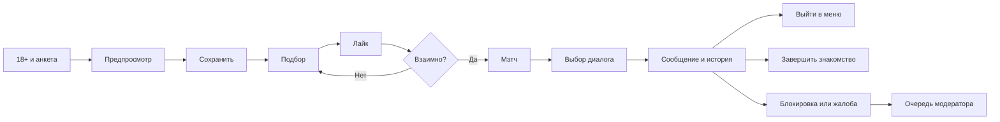

# Мэтч · интерфейс и сценарии

Новый интерфейс Mini App, темы, анимации и логотип описаны в [MINIAPP.md](MINIAPP.md). Ниже — сценарии прежнего интерфейса бота, сохраняемого для совместимости до задания публичного WEBAPP_URL.

## Характер

Молодой, спокойный и понятный. Обращение на «вы», короткие сообщения, один основной следующий шаг. Название «Мэтч» во всех основных экранах. Нативные фото-карточки и inline-кнопки: тема Telegram обеспечивает светлый/тёмный режим и доступный системный шрифт. Бот не задаёт собственные цвета кнопок и фон чата.

## Экраны

| Экран | Основное действие | Дополнительные действия |
|---|---|---|
| Приветствие | Мне есть 18 · Создать анкету | Правила |
| Анкета 1–7 | Ответ на один вопрос | Отмена |
| Предпросмотр | Всё верно · Сохранить | Заново / Отмена |
| Главная | Смотреть анкеты | Анкета / Мэтчи / Диалоги / Фильтры / Безопасность |
| Карточка | Нравится ♡ | Пропуск / Жалоба / Блокировка / Меню |
| Мэтч | Написать 💬 | Все мэтчи / Telegram-профиль |
| Диалог | Отправить текст | История / Выйти / Завершить / Жалоба / Блокировка |
| Нет анкет | Обновить | Настройки / Вернуть пропущенные |
| Моя анкета | Редактировать | Скрыть / Показать / Удалить |
| Модерация | Новые жалобы | Бан с подтверждением / Отклонение |

## Карточка

Большое фото → **имя, возраст** → город → короткое описание → два основных действия. Описание экранируется; пользователь не может подставить разметку или чужую кнопку. Номера телефонов и точная геолокация не запрашиваются.

## Диалог

Бот явно показывает имя выбранного собеседника. Каждое входящее сообщение помечено именем и содержит кнопку «Ответить», чтобы нельзя было случайно отвечать другому мэтчу. После выхода в меню выбор собеседника сбрасывается. Подтверждение доставки не выдаётся за прочтение. Ошибки доставки видны отправителю и в истории.

## Защита от ошибок

Предпросмотр перед публикацией, подтверждение удаления, подтверждение завершения знакомства и отдельное подтверждение глобального бана. Устаревшие кнопки не возобновляют завершённый мэтч. Неизвестные callback не выполняют действия. Закрытые анкеты объясняются текстом, а не пустым экраном. Редактирование сохраняет прежнюю анкету до подтверждения новой.
